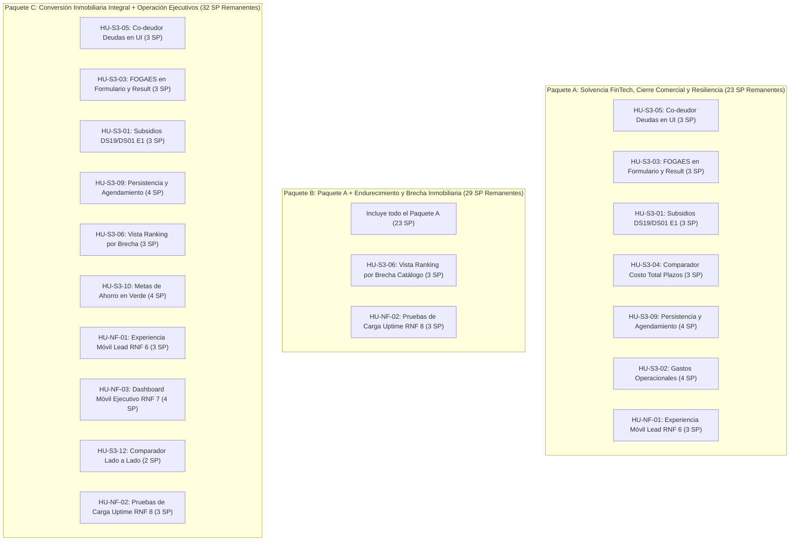

# Planificación de Historias de Usuario para Sprint 3 — RutaHogar
## Actualización de Estado de Proyecto, Trazabilidad y Estimación Remanente

Este documento contiene el catálogo oficial y actualizado de **Historias de Usuario (HUs) candidatas para el Sprint 3** de **RutaHogar**. Bajo los lineamientos de agilidad del proyecto y la evolución natural del producto:
1. **Todas las historias son extensiones directas o mejoras incrementales de funcionalidades del PMV, Sprint 1 y Sprint 2** (documentadas en [Wiki RutaHogar/UserStories](../Wiki%20RutaHogar/UserStories/index.md)).
2. **Se incorpora una auditoría de estado frente al código real:** Varias historias ya cuentan con criterios totales o parciales implementados en `develop` (como los criterios 3 y 4 de la simulación de subsidios, el cálculo backend de capacidad asistida FOGAES o el cómputo de deuda del co-deudor en `indicators.py`).
3. **Se detallan los Story Points (SP) remanentes:** Permite planificar el Sprint 3 sobre el esfuerzo de ingeniería estrictamente pendiente.
4. **De manera excepcional**, se incluyen **Historias de Usuario No Funcionales (derivadas de los RNF prioritarios)** para asegurar la usabilidad móvil y la resiliencia bajo carga en producción.

---

## 1. Resumen Ejecutivo del Backlog y Estado Frente al Código

La siguiente tabla resume el estado actual de cada historia, los criterios ya implementados en el repositorio y los **Story Points remanentes** que deben ejecutarse en el Sprint 3:

| ID Sprint 3 | Código Wiki | Historia de Usuario | HUs Base que Extiende | Estado en el Repositorio | Criterios Listos vs Pendientes | SP Orig. | SP Remanente |
| :--- | :--- | :------------------- | :-------------------- | :----------------------- | :----------------------------- | :------: | :----------: |
| **HU-S3-01** | `HU 26` | Simulación Avanzada de Subsidios Habitacionales (DS19 / DS01) | **HU 8** (S1) · **HU 5** (S1) | ⚠️ **Parcialmente lista** | ✅ **E3, E4 listos** en `Subsidios.jsx`<br>⚠️ **E2 parcial** · ❌ **E1 pendiente** | 5 | **3** |
| **HU-S3-02** | `HU 28` | Estimador Desglosado de Gastos Iniciales y Operacionales | **HU 9** (S1) · **HU 17** (S2) · **HU 4/13** | ⚠️ **Contenido listo** | ✅ Base pedagógica lista en Academia<br>❌ **E1, E2, E3, E4 cálculo interactivo pendiente** | 5 | **4** |
| **HU-S3-03** | `Propuesta FOGAES` | Declaración de Primera Vivienda y Garantía FOGAES (Pie 10%) | **HU 1** (PMV) · **HU 8** (S1) · **HU 10** (S1) | ⚠️ **Backend listo** | ✅ **E2 motor listo** (`capacidad_asistida_uf`)<br>❌ **E1 input intake** · ⚠️ **E4 desglose pendiente** | 5 | **3** |
| **HU-S3-04** | `HU 29` | Comparador de Costo Total Referencial y Sensibilidad a Plazos | **HU 17** (S2) | ⚠️ **UI Base lista** | ✅ UI de comparación existe (`ScenarioComparison.jsx`)<br>❌ **E1, E2, E3 matriz 4 plazos y CTC pendiente** | 5 | **3** |
| **HU-S3-05** | `Propuesta Co-deudor §10.1` | Transparencia y Cálculo Integral de Deudas del Co-deudor | **HU 1** (PMV) · **HU 3** (PMV) · **HU 18** (S2) | ⚠️ **Backend listo** | ✅ **E1 motor listo** (`indicators.py` suma deuda co-deudor)<br>❌ **E2, E3 en Result.jsx** · ❌ **E4 en Dashboard** | 5 | **3** |
| **HU-S3-06** | `HU 30` | Ranking de Proyectos por Brecha Mínima de Accesibilidad | **HU 6** (S1) · **HU 9** (S1) · **HU 10** (S1) | ⚠️ **Lógica lista** | ✅ **E1, E3 listos** en `compatibility.js`<br>❌ **E2, E4 vista catálogo ranking pendiente** | 5 | **3** |
| **HU-S3-07** | `HU 31 / HU 22` | Visualización y Actualización Geoespacial (Mapa Accesibilidad) | **HU 6** (S1) · **HU 7** (S1) | ❌ **Pendiente** | ❌ **E1 a E4 pendientes** (falta integrar Leaflet/OSM) | 8 | **8** |
| **HU-S3-08** | `Propuesta Unidades` | Catálogo y Matching a Nivel de Tipología y Unidad | **HU 7** (S1) · **HU 9** (S1) · **HU 10** (S1) | 🗓 **Planificado** | ❌ **E1 a E4 pendientes** (diseño listo en `UNIDADES-PROYECTO`) | 8 | **8** |
| **HU-S3-09** | `Propuesta Contacto` | Captura, Persistencia y Agendamiento Comercial | **HU 9** (S1) · **HU 2** (PMV) · **HU 12** (S2) | ⚠️ **Parcial** | ✅ RPC de contacto lista (`list_lead_contacts_email.sql`)<br>❌ **E1, E2, E3 persistencia y agendamiento pendiente** | 5 | **4** |
| **HU-S3-10** | `Propuesta Ahorro Verde` | Planificador Interactivo de Metas de Ahorro en Verde/Blanco | **HU 4** (S1) · **HU 13** (S2) | ❌ **Pendiente** | ❌ **E1 a E3 proyección en meses de obra pendiente** | 5 | **4** |
| **HU-S3-11** | `Propuesta Radar` | Radar de Oportunidades y Recálculo por Condiciones | **HU 20** (S2) | ❌ **Pendiente** | ❌ **E1 a E3 recálculo automático pendiente** | 5 | **4** |
| **HU-S3-12** | `Propuesta Comparador` | Comparador Multicriterio Lado a Lado de Proyectos | **HU 6** (S1) · **HU 9** (S1) | ⚠️ **Parcial** | ✅ Estructura base en `leadComparison.js`<br>❌ **E1 a E3 tabla comparativa paralela pendiente** | 3 | **2** |
| **HU-NF-01** | `RNF 6` *(Excepcional)* | Experiencia y Rendimiento Móvil Integral del Lead | **HU 1, 3, 4** (S1) · **HU 13, 17** (S2) | ⚠️ **Media queries listas** | ✅ Responsive básico en `styles.css`<br>❌ **E2 inputs numéricos** · ❌ **E5 pruebas 360-430px** | 5 | **3** |
| **HU-NF-02** | `RNF 8 / RNF 4` *(Excepcional)* | Disponibilidad, Resiliencia y Pruebas de Carga | **HU 3** (PMV) · **HU 10** (S1) · **HU 12** (S2) | ⚠️ **CI básico listo** | ✅ Healthchecks y smoke tests básicos listos<br>❌ **E1, E3 pruebas de carga >100 usuarios en Supabase** | 5 | **3** |
| **HU-NF-03** | `RNF 7` *(Excepcional)* | Dashboard Móvil del Ejecutivo Comercial | **HU 2** (PMV) · **HU 10** (S1) · **HU 15** (S2) | ❌ **Pendiente** | ❌ **E1 a E5 rediseño en tarjetas táctiles pendiente** | 5 | **4** |

---

## 2. Detalle de Historias de Usuario con Evidencia de Código

### Eje 1: Inteligencia Financiera, Subsidios y Co-deudoría

#### HU-S3-01: Simulación Avanzada de Subsidios Habitacionales (DS19 / DS01)
- **Código en Wiki:** [`Wiki RutaHogar/UserStories/HU26-simulacion-subsidios.md`](../Wiki%20RutaHogar/UserStories/HU26-simulacion-subsidios.md)
- **Historia Base:** Extiende [`HU 8: Detector de beneficios habitacionales`](../Wiki%20RutaHogar/UserStories/HU8-beneficios-habitacionales.md) y [`HU 5: Academia financiera`](../Wiki%20RutaHogar/UserStories/HU5-academia-financiera.md).
- **Actor:** Lead interesado en vivienda con apoyo estatal.
- **Categoría:** Deseable · **SP Original:** 5 · **SP Remanente:** **3 SP**
- **Estado Frente al Código Actual:**
  - `E1` (Cálculo del beneficio en dividendo/pie): ⚠️ **Parcial.** En `frontend/src/lib/financing/benefitScenario.js` y `FinancingSimulatorPanel.jsx` existen cálculos de aporte base y rangos referenciales, pero falta integrarlo de forma visible en el flujo guiado del lead en `Subsidios.jsx`.
  - `E2` (Requisitos de elegibilidad RSH): ⚠️ **Parcial / Avanzado.** `frontend/src/components/Subsidios.jsx:177-188` ya renderiza las condiciones cumplidas (`benefit.conditions_met`) y requisitos pendientes (`benefit.conditions_not_met`), clasificados con iconos y contadores interactivos. Falta incorporar la validación del RSH específico por tramo.
  - `E3` (Aclaración de no adjudicación automática): ✅ **LISTO.** Implementado en `Subsidios.jsx:151-156` mediante el bloque `simulation-disclaimer`: *"Importante: La información sobre beneficios habitacionales y subsidios es de carácter referencial y orientativo. No garantiza la obtención de ningún subsidio ni aprobación bancaria."*
  - `E4` (Articulación educativa con Academia): ✅ **LISTO.** Implementado en `Subsidios.jsx:190-203` mediante la función `openBenefitCapsule(benefit.academy_module)` con los botones *"Ver pasos en Academia"* y *"Ver guía para avanzar"*, enlazando directamente con los módulos temáticos de [`AcademiaFinanciera.jsx`](../frontend/src/components/AcademiaFinanciera.jsx).
- **Alcance Pendiente para Sprint 3:** Consolidar el criterio `E1` para que al seleccionar un subsidio (DS19 o DS01 Tramos 1, 2 o 3) se descuente en pantalla el aporte estatal del valor a financiar y se recalcule el dividendo referencial.

---

#### HU-S3-02: Estimador Desglosado de Gastos Iniciales y Operacionales
- **Código en Wiki:** [`Wiki RutaHogar/UserStories/HU28-gastos-iniciales.md`](../Wiki%20RutaHogar/UserStories/HU28-gastos-iniciales.md)
- **Historia Base:** Extiende [`HU 9: Cotización orientativa`](../Wiki%20RutaHogar/UserStories/HU9-cotizacion-orientativa.md), [`HU 17: Simulación financiamiento`](../Wiki%20RutaHogar/UserStories/HU17-simulacion-financiamiento.md) e impacta [`HU 4`](../Wiki%20RutaHogar/UserStories/HU4-plan-de-mejora.md) y [`HU 13`](../Wiki%20RutaHogar/UserStories/HU13-seguimiento-mensual.md).
- **Actor:** Lead / Ejecutivo comercial.
- **Categoría:** Importante · **SP Original:** 5 · **SP Remanente:** **4 SP**
- **Estado Frente al Código Actual:**
  - `E1` a `E3` (Desglose de notaría, CBRS, tasación y timbres): ❌ **Pendiente.** Aunque `frontend/src/constants/academyContent.js` define conceptualmente los rubros operacionales y `recommendationService.js` aconseja *"mantener un margen para gastos iniciales"*, no existe aún el módulo matemático que calcule los montos exactos en UF y pesos según el valor de compraventa.
  - `E4` (Sincronización con meta de ahorro): ❌ **Pendiente.** La meta de ahorro en `financialTracking.js` actualmente solo monitorea el pie; debe sumar los gastos operacionales calculados.
- **Alcance Pendiente para Sprint 3:** Implementar el calculador paramétrico de gastos de cierre (tasación: ~12 UF, notaría: ~4 UF, CBRS: 0.25%, timbres DFL2: 0.2%) y mostrar el bloque de liquidez total separando Pie de Gastos Operacionales.

---

#### HU-S3-03: Declaración de Primera Vivienda y Garantía Estatal FOGAES (Pie 10%)
- **Código en Wiki:** [`Wiki RutaHogar/UserStories/propuesta-primera-vivienda-fogaes.md`](../Wiki%20RutaHogar/UserStories/propuesta-primera-vivienda-fogaes.md)
- **Historia Base:** Extiende [`HU 1`](../Wiki%20RutaHogar/UserStories/HU1-ingreso-datos-financieros.md), [`HU 8`](../Wiki%20RutaHogar/UserStories/HU8-beneficios-habitacionales.md) y [`HU 10`](../Wiki%20RutaHogar/UserStories/HU10-matching-lead-proyecto.md).
- **Actor:** Lead de primera vivienda / Ejecutivo comercial.
- **Categoría:** Importante · **SP Original:** 5 · **SP Remanente:** **3 SP**
- **Estado Frente al Código Actual:**
  - `E2` (Motor de capacidad asistida): ✅ **LISTO EN BACKEND.** `backend/app/scoring_engine/purchase_capacity.py:106-148` ya implementa la matemática de financiamiento al 90%:
    ```python
    assisted_by_income = principal_uf / (1 - FOGAES_MIN_PIE_RATIO)  # 0.10
    assisted_by_savings = savings / FOGAES_MIN_PIE_RATIO / snapshot["uf_value_clp"]
    # Retorna capacidad_asistida_uf y fogaes_pie_ratio
    ```
    Constantes auditadas en `constants.py`: `FOGAES_MAX_PROPERTY_UF = 6000`, `FOGAES_MIN_PIE_RATIO = 0.10`.
  - `E1` (Captura del campo primera vivienda): ❌ **Pendiente.** Falta añadir el switch en `ScoreForm.jsx` y el campo opcional `primera_vivienda: Optional[bool]` en `ScoreRequest` de FastAPI.
  - `E3` (Compatibilidad y no-regresión): ✅ **LISTO.** La ausencia del campo mantiene el comportamiento estándar del 20% de pie.
  - `E4` (Trazabilidad y advertencia de dividendo): ⚠️ **Parcial.** El valor viaja en la respuesta pero falta mostrar en `Result.jsx` la comparativa de cuota mensual si se opta por el 90% LTV.
- **Alcance Pendiente para Sprint 3:** Agregar la casilla en el formulario intake (`ScoreForm.jsx`) y reflejar la capacidad asistida FOGAES en `Result.jsx`.

---

#### HU-S3-04: Comparador de Costo Total Referencial y Sensibilidad a Plazos (CTC/CAE)
- **Código en Wiki:** [`Wiki RutaHogar/UserStories/HU29-comparador-costo-credito.md`](../Wiki%20RutaHogar/UserStories/HU29-comparador-costo-credito.md)
- **Historia Base:** Extiende [`HU 17: Simulación configurable`](../Wiki%20RutaHogar/UserStories/HU17-simulacion-financiamiento.md).
- **Actor:** Lead.
- **Categoría:** Importante · **SP Original:** 5 · **SP Remanente:** **3 SP**
- **Estado Frente al Código Actual:**
  - `E1` y `E2` (Visualización de dividendo y sobrecosto de plazos): ⚠️ **Parcial.** En `frontend/src/components/financing/ScenarioComparison.jsx` existe una interfaz para comparar 2 escenarios guardados, contrastando plazos, dividendos y cargas financieras (`valueRows`). Sin embargo, no existe la proyección simultánea a 15, 20, 25 y 30 años ni el cálculo explícito del Costo Total del Crédito (CTC) acumulado.
  - `E3` (Alerta pedagógica de sobrecosto en intereses): ❌ **Pendiente.** Falta desplegar la advertencia cuando el interés total exceda el 70% del capital prestado.
  - `E4` (Consistencia matemática): ✅ **LISTO.** El cálculo de amortización y anualidad está unificado en `scoring_engine/purchase_capacity.py` y `simulation/compatibility.js`.
- **Alcance Pendiente para Sprint 3:** Crear la matriz comparativa cuadrilateral (15 vs 20 vs 25 vs 30 años) exponiendo el Costo Total del Crédito (CTC) y el delta de intereses totales pagados.

---

#### HU-S3-05: Transparencia y Gestión Integral de Capacidad Bipersonal (Co-deudor y Complemento de Renta)
- **Código en Wiki:** [`Wiki RutaHogar/UserStories/propuesta-transparencia-complemento-renta.md`](../Wiki%20RutaHogar/UserStories/propuesta-transparencia-complemento-renta.md), [`propuesta-complemento-vista-ejecutivo.md`](../Wiki%20RutaHogar/UserStories/propuesta-complemento-vista-ejecutivo.md) y [`HU18-participacion-consentimiento-codeudor.md`](../Wiki%20RutaHogar/UserStories/HU18-participacion-consentimiento-codeudor.md).
- **Historia Base que Extiende:** Extiende [`HU 1: Ingreso de datos`](../Wiki%20RutaHogar/UserStories/HU1-ingreso-datos-financieros.md) (PMV), [`HU 3: Scoring híbrido`](../Wiki%20RutaHogar/UserStories/HU3-scoring-hibrido.md) (PMV), [`HU 2: Priorización de leads`](../Wiki%20RutaHogar/UserStories/HU2-priorizacion-leads.md) (PMV) y complementa [`HU 18: Participación y consentimiento del co-deudor`](../Wiki%20RutaHogar/UserStories/HU18-participacion-consentimiento-codeudor.md) (Sprint 2).
- **Actores:** Lead (titular), Co-deudor (aportante secundario) y Ejecutivo comercial.
- **Categoría:** Esencial · **SP Original:** 5 · **SP Remanente:** **3 SP**

##### Contexto de Negocio y Deuda Técnica (Spike 1 §10.1):
En la cartera de proyectos de Echeverría Izquierdo, más del 45% de los compradores de primera vivienda requieren complementar renta para calificar. En el MVP inicial existía un defecto crítico documentado en Spike 1 §10.1: el motor de cálculo sumaba los ingresos del co-deudor pero ignoraba sus deudas mensuales, arrojando una capacidad inflada y no bancable. Además, hoy existe un silencio total hacia el usuario (si el co-deudor se rechaza por morosidad o parentesco informal, se descarta sin aviso; y si se acepta, `Result.jsx` no lo menciona) y ceguera para el ejecutivo comercial (que no sabe si un lead califica solo o con segunda firma).

##### Formulación de la Historia de Usuario (Enfoque Dual):
> **COMO** lead que complementa renta con un co-deudor para adquirir su vivienda,  
> **QUIERO** ver reflejado de forma transparente el aporte neto de mi co-deudor en la pantalla de resultados y comprender el motivo exacto si sus antecedentes fueron descartados o ajustados por la política de riesgo,  
> **PARA** tener certeza de nuestra viabilidad crediticia real y saber exactamente qué corregir antes de postular al banco.
> 
> *(Y en paralelo)*  
> **COMO** ejecutivo comercial que gestiona la cartera de prospectos,  
> **QUIERO** identificar en el panel qué leads postulan con co-deudor, filtrar la cartera por este criterio e inspeccionar el perfil de ingresos/deudas de ambos firmantes,  
> **PARA** estructurar la derivación bancaria sabiendo de antemano quiénes firman la escritura y qué condiciones financieras deben acreditarse en sala de ventas.

##### Criterios de Aceptación Exhaustivos (Formato Gherkin):
- **E1 (Cómputo Financiero Consolidado y Sin Sesgo - Backend):**  
  **Dado** que un lead ingresa antecedentes financieros propios y de un co-deudor válido,  
  **cuando** el servicio `POST /score` ejecuta el motor de cálculo (`scoring_engine/indicators.py`),  
  **entonces** la Relación Cuota-Ingreso (RCI) debe formularse obligatoriamente como `(deuda_mensual_titular + deuda_mensual_codeudor + dividendo_estimado) / (ingreso_titular + ingreso_codeudor_considerado)`, garantizando que la capacidad de compra conjunta compute todas las obligaciones de ambos firmantes.
- **E2 (Transparencia y Explicabilidad en la Vista del Lead - `Result.jsx`):**  
  **Dado** que la evaluación consideró válidamente los ingresos del co-deudor (`ingreso_complementario_considerado > 0`),  
  **cuando** el titular visualice la pantalla de resultados (`Result.jsx`),  
  **entonces** el sistema debe exhibir una tarjeta de *"Capacidad Bipersonal"* que desglosa: (1) Ingreso del titular vs ingreso aportado por el co-deudor, (2) Carga de deuda individual y consolidada, (3) Capacidad de compra adicional en UF ganada gracias al complemento, y (4) Relación de parentesco o afinidad declarada.
- **E3 (Explicación Asistida del Descarte o Inelegibilidad):**  
  **Dado** que el titular declaró datos de co-deudor pero el motor determinó su descarte (`ingreso_complementario_considerado == 0`),  
  **cuando** el usuario revise su resultado en `Result.jsx` y su plan de mejora (`HU 4`),  
  **entonces** el sistema no debe procesar la evaluación de forma silenciosa, sino desplegar un aviso pedagógico fundamentado en las señales del motor (`complemento_morosidad_alta`, `complemento_relacion_debil`, `complemento_continuidad_baja` o `complemento_deuda_alta`), ofreciendo el camino concreto para corregir la postulación.
- **E4 (Visibilidad, Desglose y Filtro en Dashboard del Ejecutivo - `DashboardLeads.jsx`):**  
  **Dado** que el ejecutivo comercial consulta la bandeja de leads priorizados,  
  **cuando** gestione su cartera,  
  **entonces** debe contar con: (1) Un badge visual *"Bipersonal"* en la fila o tarjeta del lead, (2) Un filtro selector para aislar leads *"Con Co-deudor"*, y (3) En el drawer de detalle del lead, una tabla comparativa Titular vs Co-deudor con ingresos, deudas, relación y riesgos individuales.
- **E5 (Trazabilidad, Consentimiento y Seguridad - Consent-Gated UI):**  
  **Dado** que el co-deudor es un tercero,  
  **cuando** se almacenen o expongan sus antecedentes,  
  **entonces** el sistema debe validar el registro de consentimiento conforme al flujo de [`HU 18`](../Wiki%20RutaHogar/UserStories/HU18-participacion-consentimiento-codeudor.md), aplicando políticas de Row Level Security (RLS) en Supabase para que ningún usuario no autorizado acceda a los datos financieros del co-deudor.

##### Estado Frente al Código Actual y Evidencia de Auditoría:
- `E1` (Cálculo consolidado de deuda conjunta): ✅ **LISTO EN BACKEND.** El defecto técnico Spike 1 §10.1 ya fue corregido en `backend/app/scoring_engine/indicators.py:50-61` (`deuda_total = principal_debt + complementary_debt`), verificado en `backend/tests/test_co_debtor_scoring_inputs.py`.
- `E2` (Transparencia en `Result.jsx`): ❌ **Pendiente.** `Result.jsx` no consume `ingreso_complementario_considerado` ni renderiza la tarjeta bipersonal.
- `E3` (Explicación ante descarte): ⚠️ **Parcial.** Las señales de riesgo existen en `backend/app/scoring.py:765`, pero no se transforman en copy visible al usuario en frontend.
- `E4` (Filtro y visualización en dashboard): ❌ **Pendiente.** `DashboardLeads.jsx:113` solo tiene una etiqueta estática; falta el chip de filtrado y el modal de desglose.
- `E5` (Consentimiento y seguridad): ⚠️ **Parcial.** La estructura de consentimiento se define en `HU 18`; requiere enlace visual en el frontend.

##### Plan de Tareas de Implementación (3 SP Remanentes):
1. **T1 (1.0 SP):** Componente `CoDebtorCard.jsx` en `Result.jsx` para mostrar desglose de ingresos/deudas y capacidad ganada.
2. **T2 (0.5 SP):** Mapeo de señales `complemento_*` en explicaciones pedagógicas de descarte en `Result.jsx` y `PlanMejora.jsx`.
3. **T3 (1.0 SP):** Filtro `con_codeudor` y badge visual bipersonal en `DashboardLeads.jsx`.
4. **T4 (0.5 SP):** Vista de detalle bipersonal en el drawer del ejecutivo comercial y verificación de permisos.

##### Definición de Hecho (DoD):
- [ ] `Result.jsx` exhibe el desglose de ingresos y deudas conjuntas si el co-deudor califica.
- [ ] En caso de descarte, `Result.jsx` explica con claridad la causal de riesgo sin silencios.
- [ ] `DashboardLeads.jsx` permite filtrar por leads con co-deudor y ver el detalle comparativo.
- [ ] Pruebas unitarias en Vitest para los nuevos componentes de UI y tests de integración en Pytest.

---

### Eje 2: Catálogo, Matching y Conversión Inmobiliaria

#### HU-S3-06: Ranking de Proyectos por Brecha Mínima de Accesibilidad
- **Código en Wiki:** [`Wiki RutaHogar/UserStories/HU30-ranking-proyectos-brecha.md`](../Wiki%20RutaHogar/UserStories/HU30-ranking-proyectos-brecha.md)
- **Historia Base:** Extiende [`HU 6: Simulación de compatibilidad`](../Wiki%20RutaHogar/UserStories/HU6-simulacion-compatibilidad.md) y [`HU 9: Cotización orientativa`](../Wiki%20RutaHogar/UserStories/HU9-cotizacion-orientativa.md).
- **Actor:** Lead.
- **Categoría:** Importante · **SP Original:** 5 · **SP Remanente:** **3 SP**
- **Estado Frente al Código Actual:**
  - `E1` (Ordenamiento por compatibilidad y brecha): ✅ **LISTO EN LÓGICA CORE.** La función `buildAccessibleAlternatives` en `frontend/src/lib/simulation/compatibility.js:567-595` ya calcula el `gapAmount` de cada proyecto y los ordena por menor brecha financiera (`a.gapAmount - b.gapAmount`) y estado de viabilidad.
  - `E3` (Ponderación geográfica): ✅ **LISTO.** `compatibility.js:590` ya prioriza proyectos si hay coincidencia de comuna (`communeMatch`).
  - `E2` (Visualización integral en catálogo): ❌ **Pendiente.** Actualmente esta lógica solo se consume en el modal de cotización (`ProjectEvaluationModal.jsx:80`) limitado a 3 proyectos. Falta habilitar la vista de ranking completo en el catálogo de proyectos.
  - `E4` (Comparativa con objetivo inicial): ❌ **Pendiente.** Integrar el modal comparativo directo contra el proyecto que el lead no alcanzó.
- **Alcance Pendiente para Sprint 3:** Construir la pestaña o filtro *"Proyectos más cercanos a tu capacidad"* en el catálogo de proyectos y la comparativa directa contra el proyecto meta.

---

#### HU-S3-07: Visualización y Actualización Geoespacial (Mapa de Accesibilidad)
- **Código en Wiki:** [`Wiki RutaHogar/UserStories/HU31-mapa-accesibilidad.md`](../Wiki%20RutaHogar/UserStories/HU31-mapa-accesibilidad.md) y [`HU22-actualizacion-mapa-accesibilidad.md`](../Wiki%20RutaHogar/UserStories/HU22-actualizacion-mapa-accesibilidad.md)
- **Historia Base:** Extiende [`HU 6`](../Wiki%20RutaHogar/UserStories/HU6-simulacion-compatibilidad.md) y [`HU 7`](../Wiki%20RutaHogar/UserStories/HU7-catalogo-de-proyectos.md).
- **Actor:** Lead.
- **Categoría:** Opcional · **SP Original:** 8 · **SP Remanente:** **8 SP**
- **Estado Frente al Código Actual:**
  - `E1` a `E4`: ❌ **Pendiente.** La librería `leaflet` no está instalada en `package.json`. No existen componentes de renderizado de mapas interactivos ni geolocalización de pines por comunas.
- **Alcance Pendiente para Sprint 3:** Instalar Leaflet / OpenStreetMap, crear el componente de mapa responsivo y mapear los proyectos del catálogo con semáforo verde/amarillo/rojo según el perfil del lead.

---

#### HU-S3-08: Carga de Catálogo y Matching a Nivel de Tipología y Unidad Concreta
- **Código en Wiki:** [`Wiki RutaHogar/UserStories/propuesta-carga-proyectos-por-unidad.md`](../Wiki%20RutaHogar/UserStories/propuesta-carga-proyectos-por-unidad.md) y [`propuesta-matching-nivel-unidad.md`](../Wiki%20RutaHogar/UserStories/propuesta-matching-nivel-unidad.md)
- **Historia Base:** Extiende [`HU 7`](../Wiki%20RutaHogar/UserStories/HU7-catalogo-de-proyectos.md), [`HU 9`](../Wiki%20RutaHogar/UserStories/HU9-cotizacion-orientativa.md) y [`HU 10`](../Wiki%20RutaHogar/UserStories/HU10-matching-lead-proyecto.md).
- **Actor:** Administrador inmobiliario, Lead y Ejecutivo comercial.
- **Categoría:** Importante · **SP Original:** 8 · **SP Remanente:** **8 SP**
- **Estado Frente al Código Actual:**
  - Arquitectura y esquema detallados en `docs/stories/UNIDADES-PROYECTO/PLAN.md`.
  - `E1` a `E4`: ❌ **Pendiente.** No existe la tabla `public.proyecto_unidades` en Supabase ni los selectores de tipología (Studio, 1D1B, 2D2B) en `AdminProjectCatalog.jsx` ni en la cotización.
- **Alcance Pendiente para Sprint 3:** Crear migración SQL con RLS para `proyecto_unidades`, implementar el CRUD de tipologías para el admin y habilitar la cotización por unidad específica.

---

#### HU-S3-09: Captura, Persistencia y Agendamiento de Contacto Comercial
- **Código en Wiki:** [`Wiki RutaHogar/UserStories/propuesta-captura-solicitud-contacto.md`](../Wiki%20RutaHogar/UserStories/propuesta-captura-solicitud-contacto.md)
- **Historia Base:** Extiende [`HU 9: Cotización`](../Wiki%20RutaHogar/UserStories/HU9-cotizacion-orientativa.md) y conecta con [`HU 2`](../Wiki%20RutaHogar/UserStories/HU2-priorizacion-leads.md) y [`HU 12`](../Wiki%20RutaHogar/UserStories/HU12-derivacion-comercial.md).
- **Actor:** Lead y Ejecutivo comercial.
- **Categoría:** Esencial · **SP Original:** 5 · **SP Remanente:** **4 SP**
- **Estado Frente al Código Actual:**
  - Funciones auxiliares de contacto listas en `supabase/migrations/20261008073711_list_lead_contacts_email.sql` (`list_lead_contacts`).
  - Endpoint `POST /interest` en `backend/app/main.py:534`: ❌ **Defecto activo.** Retorna éxito directo (`{"status": "success", "message": "Notificación enviada..."}`) sin persistir el lead ni la solicitud en base de datos.
  - `ProjectEvaluationModal.jsx:105-118`: Envía la petición HTTP pero ningún ejecutivo ve la solicitud.
- **Alcance Pendiente para Sprint 3:** Crear la tabla `lead_contact_requests`, persistir la solicitud asociada al usuario de sesión, agregar el selector de agendamiento (visita presencial / videollamada) y mostrar las solicitudes en `DashboardLeads.jsx`.

---

#### HU-S3-10: Planificador Interactivo de Metas de Ahorro para Proyectos en Verde / Blanco
- **Código en Wiki:** Extensión de [`HU 4`](../Wiki%20RutaHogar/UserStories/HU4-plan-de-mejora.md) y [`HU 13`](../Wiki%20RutaHogar/UserStories/HU13-seguimiento-mensual.md).
- **Actor:** Lead.
- **Categoría:** Deseable · **SP Original:** 5 · **SP Remanente:** **4 SP**
- **Estado Frente al Código Actual:**
  - `E1` a `E3`: ❌ **Pendiente.** `financialTracking.js` maneja ahorro mensual estándar, pero no modula las cuotas contra la fecha futura de entrega del proyecto (`entrega_estimada`).
- **Alcance Pendiente para Sprint 3:** Calcular la cuota mensual dividiendo el pie restante entre los meses de obra (12 a 30 meses) e incorporarla como meta dinámica en `FinancialTracking.jsx`.

---

#### HU-S3-11: Radar de Oportunidades y Recálculo Dinámico por Condiciones de Mercado
- **Código en Wiki:** [`Wiki RutaHogar/UserStories/HU20-retorno-por-cambio.md`](../Wiki%20RutaHogar/UserStories/HU20-retorno-por-cambio.md)
- **Actor:** Lead recurrente.
- **Categoría:** Deseable · **SP Original:** 5 · **SP Remanente:** **4 SP**
- **Estado Frente al Código Actual:**
  - `E1` a `E3`: ❌ **Pendiente.** `HU 20` registra cambios en el perfil del lead, pero no detecta variaciones en precios de proyectos guardados ni reajustes de tasas hipotecarias referenciales.
- **Alcance Pendiente para Sprint 3:** Implementar el recálculo reactivo en el reingreso del usuario notificando rebajas de UF o proyectos desbloqueados por variaciones de tasa.

---

#### HU-S3-12: Comparador Multicriterio Lado a Lado de Proyectos Preseleccionados
- **Código en Wiki:** Extensión de [`HU 6`](../Wiki%20RutaHogar/UserStories/HU6-simulacion-compatibilidad.md) y [`HU 9`](../Wiki%20RutaHogar/UserStories/HU9-cotizacion-orientativa.md).
- **Actor:** Lead.
- **Categoría:** Deseable · **SP Original:** 3 · **SP Remanente:** **2 SP**
- **Estado Frente al Código Actual:**
  - `frontend/src/lib/matching/leadComparison.js` ya cuenta con funciones de comparación de datos.
  - Falta renderizar la vista de tabla responsiva para contrastar hasta 3 proyectos en atributos financieros y habitacionales.
- **Alcance Pendiente para Sprint 3:** Crear la vista modal o página de comparación lado a lado consumiendo los proyectos seleccionados.

---

### Eje 3: Historias de Usuario No Funcionales Excepcionales (RNF)

#### HU-NF-01: Experiencia y Rendimiento Móvil Integral del Lead (RNF 6)
- **Código en Wiki:** [`Wiki RutaHogar/RNF/RNF6-experiencia-movil-lead.md`](../Wiki%20RutaHogar/RNF/RNF6-experiencia-movil-lead.md)
- **HUs Base:** [`HU 1`](../Wiki%20RutaHogar/UserStories/HU1-ingreso-datos-financieros.md), [`HU 3`](../Wiki%20RutaHogar/UserStories/HU3-scoring-hibrido.md), [`HU 4`](../Wiki%20RutaHogar/UserStories/HU4-plan-de-mejora.md), [`HU 13`](../Wiki%20RutaHogar/UserStories/HU13-seguimiento-mensual.md) y [`HU 17`](../Wiki%20RutaHogar/UserStories/HU17-simulacion-financiamiento.md).
- **Atributo de Calidad:** Usabilidad / Responsive · **Actor:** Lead.
- **Categoría:** Esencial · **SP Original:** 5 · **SP Remanente:** **3 SP**
- **Estado Frente al Código Actual:**
  - `styles.css` contiene media queries `@media (max-width: 640px)` para la mayoría de las vistas.
  - `ScoreForm.jsx`: ⚠️ **Parcial.** Faltan atributos `inputMode="numeric"` en varios inputs monetarios para activar teclados numéricos en iOS/Android.
  - `E5` (Pruebas formales en resoluciones móviles 360x800, 390x844 y 430x932): ❌ **Pendiente.** Se requiere suite de pruebas automatizadas con Playwright (ya instalado en `package.json`).
- **Alcance Pendiente para Sprint 3:** Ajustar inputs numéricos táctiles, eliminar scrolls horizontales en tablas y ejecutar tests Playwright de regresión visual en mobile.

---

#### HU-NF-02: Disponibilidad, Resiliencia y Pruebas de Carga del Motor de Scoring (RNF 8 / RNF 4)
- **Código en Wiki:** [`Wiki RutaHogar/RNF/RNF8-disponibilidad-escalabilidad.md`](../Wiki%20RutaHogar/RNF/RNF8-disponibilidad-escalabilidad.md)
- **HUs Base:** [`HU 3`](../Wiki%20RutaHogar/UserStories/HU3-scoring-hibrido.md), [`HU 10`](../Wiki%20RutaHogar/UserStories/HU10-matching-lead-proyecto.md) y [`HU 12`](../Wiki%20RutaHogar/UserStories/HU12-derivacion-comercial.md).
- **Atributo de Calidad:** Disponibilidad (≥95%) y Rendimiento (≤60s) · **Actor:** DevOps / Admin Dev.
- **Categoría:** Esencial · **SP Original:** 5 · **SP Remanente:** **3 SP**
- **Estado Frente al Código Actual:**
  - CI básico ejecuta pytest y vitest en GitHub Actions.
  - Endpoint `GET /health` responde en `backend/app/main.py`.
  - Pruebas de carga concurrentes (≥100 evaluaciones simultáneas sobre `POST /score` y Supabase): ❌ **Pendiente.** No existen scripts de k6 o Locust configurados para validar el SMART goal de carga ni el fallback ante demoras de Groq AI.
- **Alcance Pendiente para Sprint 3:** Implementar script de carga automatizado (Locust/k6) validando 100 usuarios concurrentes sin error 500 y con latencia ≤ 60 segundos.

---

#### HU-NF-03: Dashboard Móvil y Operación en Terreno del Ejecutivo Comercial (RNF 7)
- **Código en Wiki:** [`Wiki RutaHogar/RNF/RNF7-dashboard-movil-ejecutivo.md`](../Wiki%20RutaHogar/RNF/RNF7-dashboard-movil-ejecutivo.md)
- **HUs Base:** [`HU 2`](../Wiki%20RutaHogar/UserStories/HU2-priorizacion-leads.md), [`HU 10`](../Wiki%20RutaHogar/UserStories/HU10-matching-lead-proyecto.md) y [`HU 15`](../Wiki%20RutaHogar/UserStories/HU15-dashboard-conversion-tiempos.md).
- **Atributo de Calidad:** Usabilidad en terreno · **Actor:** Ejecutivo comercial.
- **Categoría:** Importante · **SP Original:** 5 · **SP Remanente:** **4 SP**
- **Estado Frente al Código Actual:**
  - `DashboardLeads.jsx` está diseñado para pantallas de escritorio mediante tablas. En pantallas móviles requiere scroll horizontal y dificulta la llamada o gestión de prospectos en sala de ventas.
- **Alcance Pendiente para Sprint 3:** Diseñar la variante responsive en tarjetas colapsables con botones de llamada rápida y cambio de estado comercial.

---

## 3. Paquetes de Sprint 3 Ajustados por Esfuerzo Remanente (Capacidad 25 – 35 SP Efectivos)

Al descontar el trabajo ya implementado en el repositorio (criterios 3 y 4 de subsidios, backend de co-deudor §10.1, backend de FOGAES y algoritmos de brecha de compatibilidad), el esfuerzo real para completar las historias se optimiza significativamente.

A continuación se presentan tres paquetes calibrados sobre los **Story Points Remanentes**:



---

## 4. Recomendación Técnica del Agente

Se recomienda comprometer el **Paquete B (29 SP Remanentes)** como la configuración más equilibrada para el Sprint 3:
1. **Capitaliza el avance existente:** Cierra con rapidez las historias que ya tienen el 40-50% del trabajo construido en backend (`HU-S3-01` subsidios, `HU-S3-03` FOGAES, `HU-S3-05` co-deudor y `HU-S3-06` ranking por brecha).
2. **Corrige el defecto comercial crítico:** Convierte el `POST /interest` simulado en una solicitud real persistida con agendamiento de visita (`HU-S3-09`).
3. **Garantiza calidad para paso a producción:** Asegura la experiencia móvil del lead (`HU-NF-01`) y valida formalmente que la arquitectura FastAPI + Supabase soporte la carga concurrente esperada (`HU-NF-02`).
